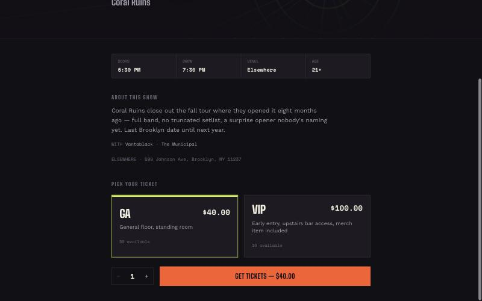
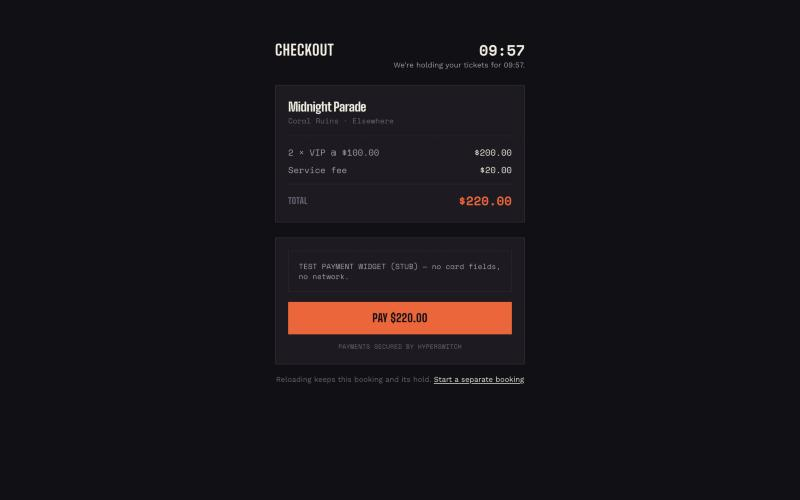
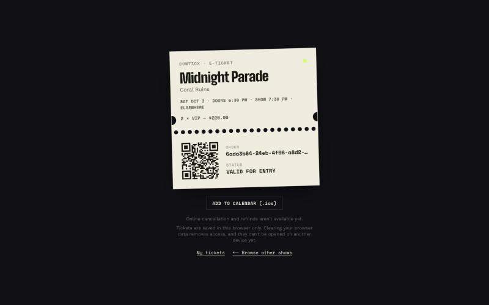
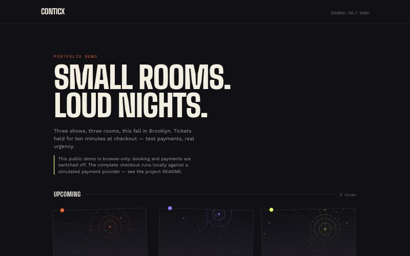
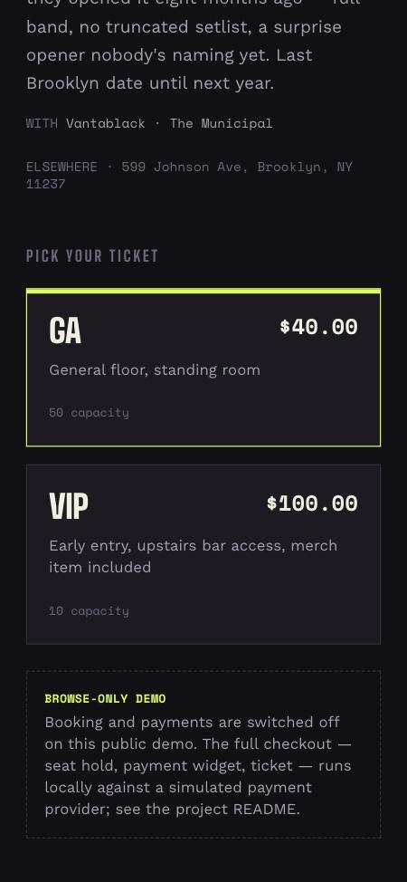
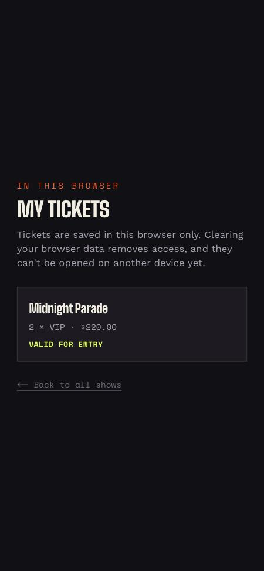
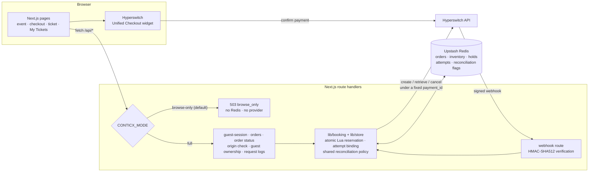

# ConTicx

ConTicx is a concert-ticket booking app built with Next.js, Upstash Redis, and
[Hyperswitch](https://hyperswitch.io)'s Unified Checkout. You browse three
fictional Brooklyn shows, pick a GA or VIP tier, get a ten-minute seat hold
at checkout, pay in the Hyperswitch widget, and receive a QR-code ticket you
can add to your calendar.

It is a portfolio project. The interesting part is not the UI but the
booking and payment correctness work underneath it: atomic inventory,
authenticated webhooks, guest ownership without accounts, idempotent booking
attempts, and conservative handling of uncertain payment outcomes. **It is
not production software**, and the limits of what has been verified are
listed below.

## Demo

There are two ways to see it.

**1. Public demo — browse-only.** The deployed site runs with booking
switched off: the home and event pages work, and every booking, order,
ticket, and webhook route refuses with `503 browse_only` *on the server*
before touching Redis or Hyperswitch. Browsing cannot reserve seats, run hold
expiry, or call the payment provider, and the deployment needs no
credentials. (The currently hosted build predates this release; replacing it
is a pending, separately approved step — see [Release status](#release-status).)

**2. Full booking flow — locally, with a simulated payment provider.** The
checkout harness runs the real app against a local Redis and an in-process
fake Hyperswitch, with the payment widget replaced by a clearly labelled stub
(`TEST PAYMENT WIDGET (STUB)`). You can book, "pay", watch the confirmation
page resolve, see the ticket in My Tickets, and download the calendar file —
in about two minutes. See [Run the full demo locally](#run-the-full-demo-locally).
**Payments in this mode are simulated**; it proves the app's own behaviour,
not compatibility with real Hyperswitch.

A step-by-step walkthrough script is in [`docs/walkthrough.md`](docs/walkthrough.md).

## Screenshots

| Event page (full mode) | Checkout (simulated widget) | Ticket |
| --- | --- | --- |
|  |  |  |

| Browse-only demo — home | Browse-only demo — event (mobile) | Ticket (mobile) | My Tickets (mobile) |
| --- | --- | --- | --- |
|  |  |  |  |

Full-mode screenshots come from the local checkout harness (simulated
provider). Browse-only screenshots come from a production build running with
no environment variables at all.

## Architecture



- **Pages** are App Router pages. Checkout loads the Hyperswitch SDK only
  once a booking is ready to pay.
- **Route handlers** are the backend, so the Hyperswitch secret key never
  reaches the browser. In full mode they check the request's `Origin`
  against `APP_ORIGIN`, authenticate the guest session, and log one
  structured line per request.
- **`lib/store.ts`** holds every state change as a Redis Lua script that
  validates before it writes. **`lib/booking.ts`** creates or resumes a
  booking's provider payment. **`lib/payment-policy.ts`** is the single
  status → action mapping shared by the webhook, the status refresh, and
  hold expiry.
- **Redis** is the only store (the event catalog is a static module). There
  is no background worker: expired holds are reconciled lazily, bounded, on
  later requests.

## Key engineering decisions

| Decision | Why |
| --- | --- |
| Prices are computed on the server from the catalog; the client sends only event, tier, quantity, and a booking-attempt id. | The browser never decides what it pays. |
| Each state change is one Redis Lua script that validates inputs and key types *before* its first write. | Lua does not roll back; checking first means a failure can't leave a half-written reservation. Concurrent buyers can't oversell. |
| Webhooks are authenticated (HMAC-SHA512 over the raw body) and treated only as notifications; the app re-reads the payment from Hyperswitch and binds it to the order (id, order, amount, currency) before acting. | A forged or stale webhook can't mark an order paid. |
| One provider status → action policy for webhooks, status refreshes, and expiry; a failed payment is retained, not released. | The three paths can't disagree, and a retryable failure doesn't free a seat. |
| Guest ownership instead of accounts: a 256-bit HttpOnly session cookie; only its SHA-256 hash is stored, bound to each order inside the reservation. | Order ids and payment ids are not access credentials. Missing and foreign orders get the same 404. |
| A booking attempt id (per *Get tickets* click) is bound atomically to one order. | Reloads, retries, lost responses, and concurrent submissions return the same order, hold, and price instead of booking again. |
| The provider `payment_id` is chosen and stored before any provider call; every creation retry reuses it. | Relies on Hyperswitch's documented creation idempotency for merchant-provided ids, so retries don't create unrelated payments. |
| Payment creation never releases seats; uncertain or refused outcomes are kept and flagged for reconciliation. | No provider response proves a payment doesn't exist; seats are released only on authoritative evidence. |
| `CONTICX_MODE=full` is the only way to enable booking. | A deployment that forgets the setting fails safe (browse-only). |
| Structured JSON logs with server-generated request ids and an allow-list of fields. | Requests can be correlated without logging cookies, owner hashes, client secrets, bodies, or provider payloads. |

The full reasoning, failure tables, and provider-contract sources are in
[`docs/testing.md`](docs/testing.md).

## What it does

- Browse events; pick a tier and quantity (up to 4).
- Checkout holds the seats for ten minutes and shows a live countdown.
  Reloading resumes the same booking and the same countdown; *Start a
  separate booking* is a deliberate, different action.
- Pay in the Hyperswitch widget (card in-page, or redirect flows that return
  to `/confirmation/<order id>`).
- The confirmation page polls the order's status — refreshed from the
  provider on the server, for the owner only — until it resolves.
- Tickets show doors and show times, a QR code of the order id, and an
  **Add to calendar (.ics)** download.
- **My Tickets** lists the orders this browser owns.
- Online refunds and the organizer view are deliberately disabled (see
  limitations).

## Run the full demo locally

Requirements: Node 24 (see `.nvmrc`), Docker, and npm.

```bash
npm ci
docker compose -f docker-compose.test.yml up -d --wait
tests/browser/checkout-harness/run.sh
```

`run.sh` exports the current commit to a temporary directory, swaps the two
Hyperswitch widget packages for local stubs (harness-only Next config — the
real `next.config.ts` is untouched), starts the in-process fake Hyperswitch
with a control port, and runs the app with `CONTICX_MODE=full` and only
loopback endpoints and fake keys. It never reads `.env.local`.

Then open <http://127.0.0.1:3000>:

1. Pick a show and tier, press **Get tickets** — checkout shows the order
   summary, the countdown, and the stub widget.
2. Press **Pay**. The confirmation page polls while the simulated payment is
   pending.
3. Move the simulated payment to `succeeded`:

   ```bash
   curl -s http://127.0.0.1:38172/payments   # find the payment_id
   curl -s -X POST "http://127.0.0.1:38172/set-status?payment_id=<id>&status=succeeded"
   ```

4. The ticket appears; **Add to calendar** downloads an `.ics`. **My
   Tickets** lists the order.

To exercise failure handling, `POST http://127.0.0.1:38172/knobs` with
`createFailsAfterInsert=1`, `getReturns500=1`, or
`createResponseDelayMs=<ms>` (see
[`tests/browser/checkout-harness/fake-provider.ts`](tests/browser/checkout-harness/fake-provider.ts)).

### Running against your own Hyperswitch sandbox

```bash
cp .env.example .env.local   # then fill it in
npm run dev
```

| Variable | Purpose |
| --- | --- |
| `CONTICX_MODE` | `full` enables booking; anything else is browse-only |
| `APP_ORIGIN` | The app's exact origin, e.g. `http://localhost:3000`; browser mutations from any other origin are refused |
| `HYPERSWITCH_API_KEY` / `NEXT_PUBLIC_HYPERSWITCH_PUBLISHABLE_KEY` | Sandbox keys (`snd_` / `pk_snd_`) |
| `HYPERSWITCH_BASE_URL` | `https://sandbox.hyperswitch.io` |
| `HYPERSWITCH_WEBHOOK_SECRET` | The business profile's `payment_response_hash_key`; without it webhooks are refused |
| `UPSTASH_REDIS_REST_URL` / `UPSTASH_REDIS_REST_TOKEN` | A Redis database used only for this app |

Use isolated test resources only. Real Hyperswitch behaviour has not been
verified as part of this project (see limitations).

### Browse-only

Run with `CONTICX_MODE` unset (or anything other than `full`). No other
variables are required.

## Testing

```bash
npm run lint
npm run typecheck          # next typegen && tsc --noEmit
npm run test:unit          # no Docker needed
npm test                   # unit + integration (Docker test Redis required)
npm run build
```

239 tests in 27 files (45 unit, 194 integration). Integration tests drive the
real route handlers against a dedicated local Redis (behind the same REST
protocol as Upstash) and an in-process fake Hyperswitch, and assert on raw
stored state and recorded provider calls — not only HTTP responses. A
loopback-only network guard makes it impossible for the suite to reach a
real service. Highlights:

- concurrency: overselling, double releases, concurrent duplicate bookings;
- webhooks: forged, tampered, replayed, and out-of-order deliveries;
- guest isolation, legacy-order inaccessibility, origin checks;
- booking-attempt replay and every payment-creation failure boundary,
  including deterministic tests of stale workers in the pre-association
  window;
- the real checkout component under React Strict Mode (jsdom);
- calendar file content, structured logs and secret exclusion, and
  browse-only enforcement.

`scripts/spike-test.ts` fires concurrent bookings at a running local
instance and checks the raw inventory counter. Details of what each suite
proves — and what it does not — are in [`docs/testing.md`](docs/testing.md).

## Observability

This is **structured logging with request correlation, not distributed
tracing**. The booking, order-status, and webhook routes run inside a small
wrapper ([`lib/log.ts`](lib/log.ts)) that gives each request a
server-generated id, returns it as `X-Request-Id`, and writes one JSON line
through the runtime console:

```json
{"ts":"…","level":"info","event":"request","requestId":"req_…","op":"booking.create","outcome":"ready","status":200,"durationMs":29,"orderId":"…","eventId":"midnight-parade","replayed":false}
```

- Only allow-listed fields are written. Errors are logged by class name
  only, because Redis error messages can embed command arguments such as an
  order's owner hash.
- An inbound `x-request-id` / `x-vercel-id` is kept separately as
  `upstreamRequestId`, and only if it is short and well-formed.
- Logging failures are swallowed and never change a response.

No external monitoring service or logging dependency is used.

## Known limitations and deferred work

- **Not verified against real Hyperswitch.** Webhook delivery and signing,
  redirect and wallet returns, duplicate-`payment_id` behaviour, and
  retrieval semantics follow the documentation and upstream source, but have
  not been exercised against the sandbox. Hosted Upstash parity is likewise
  unverified.
- **No background recovery.** Uncertain or refused payment outcomes, and
  payment-less expired holds, stay held and flagged in `reconcile_needed`;
  nothing resolves them yet, and flags are not cleared automatically.
- **Refunds and the organizer view are disabled.** The refund endpoint
  answers `503`; there is no admin login.
- **Same-browser tickets only.** No accounts, email, or cross-device
  recovery; clearing browser data removes access. Two brand-new tabs racing
  on a first visit can end up with different guest sessions.
- **No rate limiting** on any route.
- **Fictional catalog.** Three hard-coded shows dated autumn 2026. Times are
  shown in the viewer's local time zone; the calendar file uses the exact
  instant.
- **Not production-ready.** No load testing, no production deployment
  review, no real payments.

## Release status

This branch prepares release notes for **v0.1.0**
([`docs/release-notes/v0.1.0.md`](docs/release-notes/v0.1.0.md)). The tag,
the GitHub release, and replacing the hosted demo with the browse-only build
are separate steps that have not been taken. Automatic Vercel Git
deployments are disabled in [`vercel.json`](vercel.json).

## Documentation

- [`docs/testing.md`](docs/testing.md) — test strategy, per-phase guarantees,
  failure tables, provider-contract sources.
- [`docs/deploy-prerequisites.md`](docs/deploy-prerequisites.md) — what must
  be true before anything is deployed.
- [`docs/walkthrough.md`](docs/walkthrough.md) — demo recording script.
